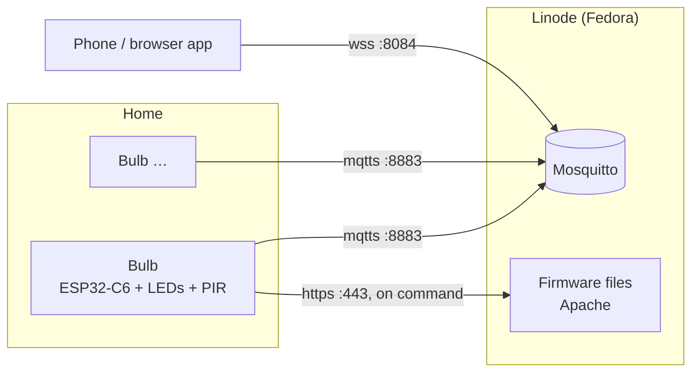

# Pico Bulbs: setup guide

This guide takes you from nothing to a working smart bulb. Follow the steps in order.

| # | Guide | Result |
|---|-------|--------|
| 1 | [Hardware & wiring](01-wiring.md) | A C6-Zero with LED strip and PIR sensor on the bench |
| 2 | [Broker on the server](02-broker.md) | Mosquitto with TLS at `mqtt.apicov.xyz` |
| 3 | [Firmware: configure, flash, test](03-firmware.md) | A bulb that you control with `mosquitto_pub` |
| 4 | [App](04-app.md) | Control your bulbs from a phone or browser |

**Already set up?** These are the parts of the firmware guide you'll come back to:

- [Update over WiFi](03-firmware.md#update-over-wifi): build, publish and install new firmware
- [Debug a bulb remotely](03-firmware.md#debug-a-bulb-remotely): health, logs and crash reports
- [Before you seal a bulb](03-firmware.md#before-you-seal-a-bulb): what to check while you still have USB

## How it fits together

- **Bulbs work on their own.** Fades, saved state, the sleep timer and the alarm all run on the bulb itself. The app only sends commands such as "red, 60%" and shows each bulb's state.
- **MQTT topics:** `pico/bulb/<id>/status | state | set | motion | schedule | schedule_set | cmd | info | log | coredump`. Payloads use Home Assistant's JSON light schema; see [the topic reference](../broker/README.md#topic-and-payload-reference).
- **Without internet** the bulbs still light up and keep their last setting, but the app can't reach them. That's because the broker lives on the Linode.
